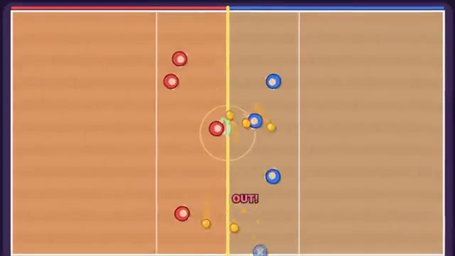

# Dodgeball Duel

Rush the line, throw, dodge, catch to send them out. A multiplayer starter game from [Multiplayer Agent](https://multiplayeragent.com): 2D, versus, 2–10 players, with bots that fill empty seats.

## How it plays

Race to the five balls on the middle line, then throw at the other team. Get hit and you're out to the bench; press Catch right as a ball reaches you and the thrower is out instead. Last team standing wins the round; first to three rounds wins.

**Controls:** WASD or arrows to run, aim with the mouse, click or Space to throw, Shift or right-click to catch, or a thumb stick with Throw and Catch buttons.

## Make it yours in the Game Builder

Open the [Game Builder](https://multiplayeragent.com), choose **Start from a starter game** and pick Dodgeball Duel. It opens as version 1 in your studio, ready to play and publish. Then ask for changes, for example:

- Add a golden ball that knocks out two players
- When you catch a ball, bring a teammate back from the bench
- Make the court shrink as the round goes on

## Run it yourself

1. Get a free publishable key (`pk_…`) at [multiplayeragent.com](https://multiplayeragent.com).
2. In `index.html`, put it in place of `pk_REPLACE_ME` in the `MP_CONNECT` block.
3. Open `index.html` in a browser. No build step and no server needed.

Without a key it still runs, offline against bots.

## How it is built

- One `index.html`. The comment at the top of the script maps the code and explains the multiplayer.
- **Host-run rounds:** One player's browser keeps the balls, the rounds and who is out; if it leaves, the next player takes over.
- **Leaderboard:** Most players knocked out, for every player.
- **Bots:** Bots fill every empty spot, so it's always at least 4 against 4: they grab balls, throw, dodge and sometimes catch.
- **Live sync:** Every player and every ball in flight show up on all screens at once; a ball that reaches you is decided on your screen, so a dodge you see is a dodge.
- `?attract` runs it offline, bots only. The preview video is recorded from it.

## License

MIT.
